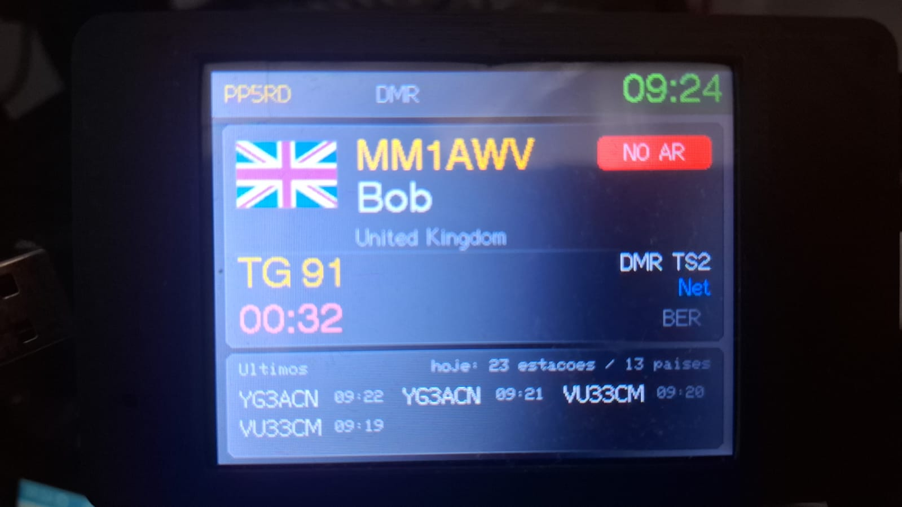
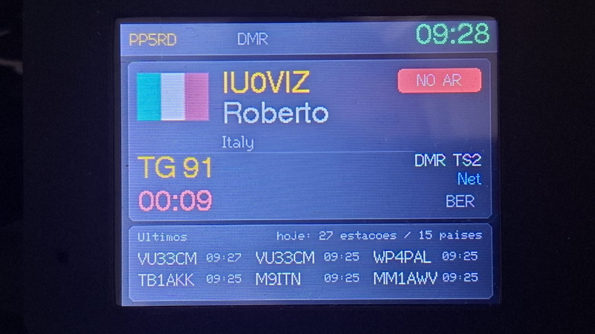

# pistar-cyd-panel

🇬🇧 English · 🇧🇷 [Português](README.pt-BR.md)

A **"who is talking now"** panel for Pi-Star on a **2.8" CYD** (ESP32-2432S028R,
the "Cheap Yellow Display").

It shows the station currently transmitting on your DMR hotspot: **country flag, callsign,
name, country, talkgroup, timeslot, source (local RF or network), QSO timer, BER and loss**,
plus the last heard stations and the number of stations and countries heard today.

## Photos





(The panel text is in Portuguese: "NO AR" = on air, "Ultimos" = last heard,
"hoje" = today, "estacoes" = stations, "paises" = countries.)

```
┌──────────────────────────────────────┐
│ PY0XXX DMR                     14:32 │
│ ┌──────────────────────────────────┐ │
│ │ [flag]      PY2XXX      ( NO AR )│ │
│ │             Joao                 │ │
│ │             Brazil               │ │
│ │ TG 72453            DMR TS2      │ │
│ │                     Net          │ │
│ │ 00:47          BER 0.0%  loss 0% │ │
│ └──────────────────────────────────┘ │
│ ┌ Last           today: 89 / 31 ───┐ │
│ │ ZL1AG 14:30  VE9HI 14:29  ...    │ │
│ └──────────────────────────────────┘ │
└──────────────────────────────────────┘
```

## How it works

```
Pi-Star (MMDVMHost)                         CYD (ESP32)
  /var/log/pi-star/MMDVM-*.log                 │
        │  pistar-cyd-panel.py (service)       │  every 1-2 s
        ▼                                      │
  /run/pistar-cyd-panel/status.json  ◄─────────┘  GET http://<pi-star>/cyd/status.json
  /usr/local/share/.../flags/<cc>.565 ◄─────────  GET http://<pi-star>/cyd/flags/br.565
```

- The **collector** runs on the Pi-Star itself and reads the MMDVMHost log. It does not
  depend on the dashboard HTML, so it keeps working if the dashboard is updated or customized.
- **Name and country** come from the RadioID databases that Pi-Star already downloads daily
  (`/usr/local/etc/nextionUsers.csv`; fallback: `DMRIds.dat` + the MCC prefix of the DMR ID).
- The JSON lives in **memory** (`/run`), so nothing is written to the SD card.
- Pi-Star's nginx already serves the files: no new port, no firewall rule.
- It does not change any dashboard file. It only adds the link `/var/www/dashboard/cyd`.

## Requirements

- Pi-Star 4.x with DMR (tested on **Pi-Star 4.2.6**, Raspberry Pi Zero W, Python 3.9).
- A **2.8" ESP32-2432S028R CYD** (ILI9341 display, 320x240).
- To flash: a computer with Chrome/Edge (flash from the browser) or `esptool`.

## 1. Install on the Pi-Star

Log in to the Pi-Star over SSH (user `pi-star`) and run:

```bash
cd /tmp
curl -L -o pcp.tar.gz https://github.com/danielregis81/pistar-cyd-panel/archive/refs/heads/main.tar.gz
tar xzf pcp.tar.gz
cd pistar-cyd-panel-main/pistar
sudo ./install.sh
```

At the end the installer prints the address, for example
`OK: dados em http://192.168.0.100/cyd/status.json`.
Write down that IP: you will need it when configuring the CYD.

To check, open that address in a browser. You should see a JSON with `"ok":true`.

The installer:
- copies the collector to `/usr/local/lib/pistar-cyd-panel/` and the flags to
  `/usr/local/share/pistar-cyd-panel/flags/`;
- creates the `pistar-cyd-panel` service (starts at boot and restarts itself if it dies);
- creates the link `/var/www/dashboard/cyd`;
- puts the filesystem back to read-only at the end, if it was read-only before.

To remove: `sudo ./uninstall.sh` (in the same folder).

## 2. Flash the CYD (no compiling)

The ready-made firmware is [`bin/pistar-cyd-panel.bin`](bin/pistar-cyd-panel.bin)
(full image: flash it at address **0x0**).

**From the browser (Chrome or Edge on a computer):**
1. Plug the CYD into USB.
2. Open https://espressif.github.io/esptool-js/ and click **Connect**, choosing the CYD's port.
3. Leave **Flash Address** at `0x0`, choose the file `pistar-cyd-panel.bin` and click **Program**.

**From the terminal (esptool):**
```bash
pip install esptool
esptool.py --chip esp32 write_flash 0x0 bin/pistar-cyd-panel.bin
```

## 3. Configure from your phone

1. Power on the CYD. On first use it shows a WiFi network called **`PiStar-CYD-XXXX`** on screen.
2. On your phone, join that network and open **http://192.168.4.1** (many phones open it automatically).
3. Pick your home network, type the password, type the **Pi-Star IP** and choose your time zone.
   Tap **Save**.
4. The CYD restarts, connects and starts showing who is talking.

**Pi-Star address:** use the IP that `install.sh` printed at the end (for example `192.168.0.100`).
The name `pi-star.local` also works, but not every network resolves `.local` names reliably.
Tip: reserve a fixed IP for the Pi-Star in your router so it does not change.

**To change the configuration later:** hold the CYD's **BOOT** button for 3 seconds
(or power it on while holding BOOT). The `PiStar-CYD-XXXX` network appears again.

If the CYD cannot connect to WiFi within 30 s, it opens the configuration by itself.
The configuration is stored on the board and survives power-off.

## Remote access (optional)

If you want to monitor your hotspot from outside your home network (for example, when the
hotspot is portable or at a friend's house), you can use a **tunnel** like Cloudflare Tunnel,
ngrok or similar.

Just point the tunnel to your Pi-Star's IP and use the **external domain** in the CYD
configuration instead of the local IP. For example: `pistar.example.com`.

The firmware automatically detects when you use a domain name (instead of an IP or `.local`)
and switches to **HTTPS**. No extra configuration is needed.

**Note:** HTTPS connections are slower than local HTTP due to TLS handshake. The panel
may take a bit longer to load flags the first time.

## Building it yourself (optional)

1. Install the **esp32 3.x** core and the **TFT_eSPI** and **ArduinoJson 7** libraries.
2. Copy [`firmware/User_Setup.h`](firmware/User_Setup.h) into the TFT_eSPI library folder,
   replacing the `User_Setup.h` that is there
   (Linux/Mac: `~/Arduino/libraries/TFT_eSPI/`, Windows: `Documents\Arduino\libraries\TFT_eSPI\`).
3. Board **ESP32 Dev Module**:
   ```bash
   arduino-cli compile --fqbn esp32:esp32:esp32 --export-binaries firmware/pistar-cyd-panel
   arduino-cli upload  --fqbn esp32:esp32:esp32 -p /dev/ttyUSB0 firmware/pistar-cyd-panel
   ```

## Troubleshooting

| Symptom | What to do |
|---|---|
| Wrong colors (green looks purple) or "negative" image | In `User_Setup.h`, change `TFT_BGR` to `TFT_RGB` or comment out `TFT_INVERSION_ON`. |
| White or black screen | Your CYD may be the ST7789 variant (2 USB ports). Replace `ILI9341_2_DRIVER` with `ST7789_DRIVER`. |
| "Procurando o Pi-Star..." (searching for Pi-Star) | Check that `http://<pi-star-ip>/cyd/status.json` opens in a browser. If it does, hold BOOT for 3 s and check the address you typed (prefer the IP). |
| Station without name or country | The callsign is not in the RadioID database. The Talker Alias name is used when available. |
| JSON does not appear after installing | Run `sudo journalctl -u pistar-cyd-panel -n 30` on the Pi-Star. The first read can take a few seconds on a Pi Zero. |

## Limitations

- Built for a **simplex, single-slot hotspot** that monitors **one timeslot** at a time.
  The screen shows the last transmission, whichever slot it came from. On a **duplex**
  hotspot (TS1 and TS2 at the same time) it works, but shows only one QSO at a time.
- DMR only, for now (D-Star, YSF, P25 and NXDN do not appear).
- The panel is read-only, with no touch input.
- The daily count restarts when the Pi-Star reboots (the log is kept in memory).

## Ideas for the future

- A panel for **duplex hotspots**: TS1 and TS2 side by side, each with its own caller.
- Other modes (YSF, D-Star, NXDN).

## For maintainers

The flags (`pistar/flags/*.565`) and the country map (`pistar/countries.json`) are generated by:

```bash
pip install pillow
python3 tools/make_flags.py
```

## Credits and license

- Code: MIT license (see [LICENSE](LICENSE)).
- Flags: [flagcdn.com](https://flagcdn.com), public domain images (Wikimedia Commons).
- MCC → country table: [pbakondy/mcc-mnc-list](https://github.com/pbakondy/mcc-mnc-list) (MIT).
- Station data: [RadioID.net](https://radioid.net), downloaded by the Pi-Star itself.

73!
